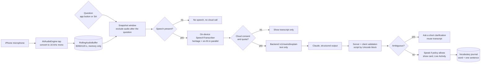
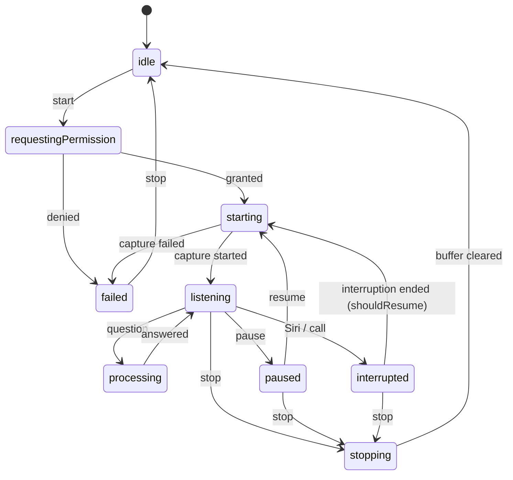

# Architecture

## Repository layout

```
Languify/
  project.yml                 XcodeGen definition (generates Languify.xcodeproj)
  Config/                     xcconfig files; Local.xcconfig (git-ignored) holds team id and backend URL
  Packages/LanguifyKit/       Platform-independent core, tested with `swift test`
  App/Sources/                iOS app (SwiftUI, Swift 6, MainActor default isolation)
  Shared/                     Code compiled into both the app and the widget extension
  Widgets/                    Live Activity extension
  AppTests/, AppUITests/      App unit/integration tests and UI journeys
  backend/                    TypeScript API (Fastify) that talks to the AI provider
  docs/                       This documentation
```

## Modules

| Area | Where | Responsibility |
|---|---|---|
| Domain models | `LanguifyKit/Rewind`, `Settings`, `Language` | Transcript, request and response contracts, preferences, language configuration |
| Audio buffer and session state | `LanguifyKit/Audio` | `RingBuffer`, thread-safe `RollingAudioBuffer`, pure `ListeningStateMachine` |
| Learning engine | `LanguifyKit/Learning` | FSRS v4.5 scheduler, review queue, multidimensional learner profile, quiz generator, pronunciation scorer |
| Monetization rules | `LanguifyKit/Monetization` | Plan catalogue, daily usage ledger, entitlement resolver |
| Networking | `LanguifyKit/Networking` | Typed backend client, error mapping, token protocol |
| Audio capture | `App/Sources/Audio` | `AVAudioSession` setup, interruptions, routes; `AVAudioEngine` tap converting to 16 kHz mono; `ListeningSessionManager` |
| Speech | `App/Sources/Speech` | `OnDeviceTranscriber` (`SpeechAnalyzer`), model download management |
| AI orchestration | `App/Sources/Rewind` | `LiveRewindService` pipeline, `ResponseDelivery` (speech output policy), opt-in `SuggestionService` |
| Persistence | `App/Sources/Persistence` | SwiftData models (CloudKit-compatible), `VocabularyRepository` |
| Accounts | `App/Sources/Account` | Keychain, guest and Apple session tokens, Sign in with Apple |
| Subscriptions | `App/Sources/Store` | StoreKit 2 products, purchase, restore, entitlement refresh and server confirmation |
| Siri | `App/Sources/Intents`, `Shared/` | App Intents, App Shortcuts, Live Activity stop intent |
| Presentation | `App/Sources/Features`, `Design` | SwiftUI screens, one feature per folder |
| Backend | `backend/src` | Auth, rate limiting, quotas, validation, Claude provider, StoreKit JWS verification |

`AppServices` is the composition root: it creates every service once, wires dependencies explicitly, is injected into SwiftUI through the environment, and is registered with `AppDependencyManager` so Siri intents use the same live session and buffer as the UI.

## Live Rewind pipeline



Design choices:

- **Transcribe on demand, not continuously.** Transcribing the whole conversation would mean holding a transcript of everything said. Instead audio sits in the ring buffer and only the window the learner asks about is transcribed. Measured transcription speed (about 0.5 s for a sentence on Apple silicon) makes this fast enough.
- **Text, not audio, leaves the device.** The model sees the transcript of the requested window. This is both the privacy boundary and the reason the backend never handles audio.
- **Two recognisers in parallel.** The heritage model already keeps English words in code-switched speech; the `en-IN` pass is a cross-check. A failing English pass never blocks an answer.
- **The question's timestamp bounds the window.** `snapshot(endingAt:)` excludes audio captured after the learner asked, so their own voice is not analysed.
- **Interruptions keep the buffer.** When Siri or a call takes the mic, capture stops but the buffer stays, which is exactly what a Siri question needs.
- **Confidence is never invented.** Recogniser confidences come from `transcriptionConfidence`; the AI is instructed never to output numbers, and the UI marks low-confidence segments with an icon rather than a percentage.
- **Clarify instead of guessing.** The response contract has a `needs_clarification` status with options, and an `uncertain` status with alternatives. Uncertain answers are not auto-saved.

## Listening session states



Invalid events are rejected by `ListeningStateMachine` rather than producing inconsistent state.

## Data model

`VocabularyEntry` (SwiftData) stores the word in native script and transliteration, English and contextual meaning, pronunciation hint, register, usage/cultural/regional notes, one example, the single sentence it was heard in, source, timestamps, encounter count, favorite and mastery flags, the learner's corrections (with the original AI meaning kept), and FSRS state (stability, difficulty, due date, counts). `ReviewRecord` stores each review grade. Every property has a default and there are no unique constraints, so CloudKit sync can be enabled without migration. De-duplication uses `VocabularyKey` (native script if present, otherwise normalised romanisation).

Preferences, the learner profile and the local usage ledger are small JSON documents in `UserDefaults`. Tokens live in the Keychain (`AfterFirstUnlockThisDeviceOnly`, so Siri can use them while locked).

## Identity, sync and monetization

- **Guest first.** Each install gets an anonymous id and a backend token. No account is needed for anything.
- **Sign in with Apple** links the install to a stable user on the backend, which merges the guest's usage and entitlement. It is an identity for quotas and subscriptions only.
- **iCloud sync** is separate: SwiftData's CloudKit store under the device's iCloud account, opt-in, takes effect on next launch, and falls back to a local store if CloudKit is unavailable. Signing in with Apple does not turn on iCloud, and vice versa.
- **Subscriptions** use StoreKit 2. The app derives the tier from verified `Transaction.currentEntitlements` and sends the signed transactions to the backend, which verifies them with Apple's App Store Server Library. Quotas are enforced server-side; the client copy only explains limits early. Plans, features and limits are configuration served from `GET /v1/config`; prices always come from the App Store.

## Backend

See [BACKEND.md](BACKEND.md).
